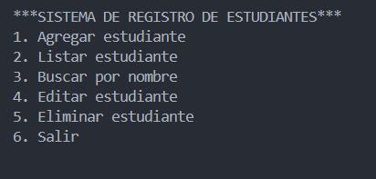

# Sistema de Registro de Estudiantes

## Descripción
Este proyecto implementa un sistema CRUD (Crear, Leer, Actualizar, Eliminar) para gestionar registros de estudiantes. Permite almacenar y manipular información como nombre, ID, carrera y promedio académico de los estudiantes.

## Características
- Agregar estudiantes : Registra nuevos estudiantes con validación de datos.
- Listar estudiantes : Muestra todos los estudiantes registrados en el sistema.
- Buscar por nombre : Encuentra uno o más estudiantes mediante coincidencias parciales en su nombre.
- Editar información : Actualiza los datos de estudiantes existentes.
- Eliminar registros : Elimina estudiantes del sistema.
- Persistencia automática en CSV : Guarda los cambios en un archivo CSV después de agregar, editar o eliminar estudiantes.

## Estructura del Proyecto

```
sistema-registro-estudiantes/
├── Main.java                  # Punto de entrada de la aplicación
├── model/
│   └── Estudiante.java        # Clase modelo para los estudiantes
├── service/
│   └── EstudianteService.java # Servicios para gestionar estudiantes
└── archivos csv/
    └── estudiantes.csv        # Archivo de exportación de datos
```

## Captura de la Aplicación


## Tecnologías Utilizadas
- Java
- Programación Orientada a Objetos (POO)
- Colecciones (ArrayList)
- Organización por responsabilidades: interfaz de consola, modelo y servicio

## Requisitos
- JDK 8 o superior
- Entorno de desarrollo Java (Eclipse, IntelliJ, etc.)

## Cómo Ejecutar
1. Compile los archivos Java:

```bash
javac Main.java model/Estudiante.java service/EstudianteService.java
```

2. Ejecute la aplicación:

```bash
java Main
```

## Funcionalidades Detalladas
### Gestión de Estudiantes
- Los estudiantes se identifican con un ID único generado automáticamente (formato: EST001, EST002, etc.)
- Se valida que los campos no estén vacíos
- El promedio debe estar en el rango de 1.0 a 7.0
- La búsqueda por nombre ignora mayúsculas y minúsculas, y muestra todas las coincidencias parciales

### Persistencia en CSV
- Los datos se guardan automáticamente en un archivo CSV ubicado en la carpeta "archivos csv"
- El formato incluye: ID, Nombre, Carrera, Promedio

## Demostración de Conceptos
Este proyecto demuestra:

- Comprensión de Programación Orientada a Objetos
- Uso de colecciones en Java
- Separación de responsabilidades entre la interfaz de consola (`Main`), el modelo (`Estudiante`) y la lógica de gestión (`EstudianteService`)
- Validación de datos de entrada
- Manejo de archivos

## Autor
Patricio Fernández

## Licencia
Este proyecto está bajo la [licencia MIT](LICENSE).

